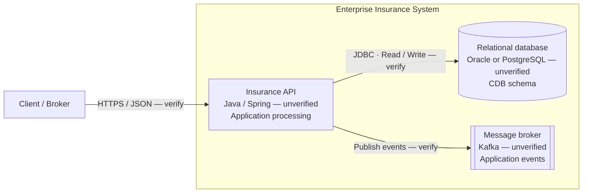
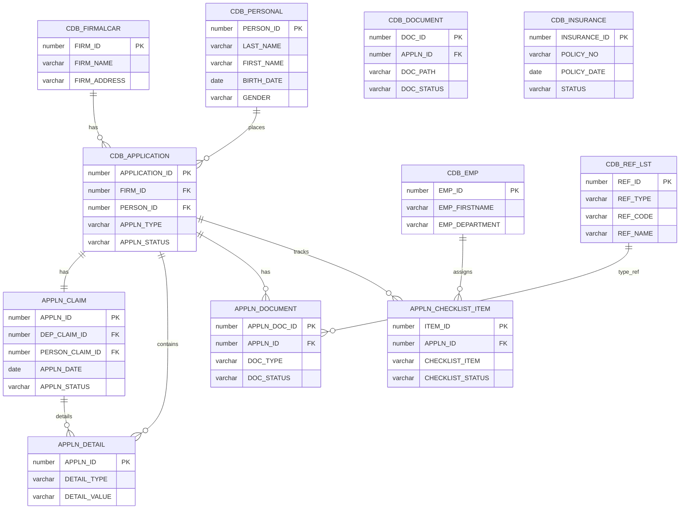

# Enterprise Insurance System — Architecture Case Study

> **Real project documentation.** This case study documents a real Enterprise Insurance System project. The available source materials describe a server-based system and provide C4 and ERD models. The public diagrams preserve the supplied model; they are not an independent verification of the production deployment. The available evidence does not yet confirm the database engine (Oracle or PostgreSQL), the Java/Spring implementation, Kafka usage, or the physical/runtime relationships between the depicted elements. These open verification points concern implementation details, not whether the project itself was real.

## Scope

This case study documents two complementary views:

- **Container view (C4-inspired):** the components and connections shown in the supplied C4 model. Their placement is preserved as source material; it does not by itself establish deployment units, infrastructure ownership, or runtime topology.
- **Data view (ERD):** CDB and APPLN entities, attributes, key markers, and relationships supplied in the source model. No additional relationships are inferred.

## 1. Container architecture

The source used the C4 `C4Container` notation. For reliable rendering in GitHub README files, the following equivalent high-level view uses standard Mermaid flowchart syntax.

### Components

| Component | Technology / evidence status | Responsibility stated in the model |
|---|---|---|
| Client / Broker | External user | Submits and follows up applications |
| Insurance API | Java / Spring — not independently verified against implementation artefacts | Application processing and business logic |
| Relational database | Oracle or PostgreSQL — alternatives; actual engine not verified | Stores CDB data |
| Message broker | Kafka — not independently verified against configuration or runtime artefacts | Carries application events |

The connection labels in the diagram (HTTPS/JSON, JDBC read/write, and event publishing) are retained from the supplied model and require the same implementation-level verification.

## 2. Database entity-relationship diagram

The diagram below preserves the entities and relationships from the supplied model. It intentionally does not add inferred foreign keys.

## 3. Data model notes and validation points

The following points need confirmation against DDL, ORM mappings, or application code:

1. `CDB_DOCUMENT.APPLN_ID` is marked as an FK in the supplied attributes, but its relationship to `CDB_APPLICATION` was not included in the supplied relationship list.
2. `APPLN_CHECKLIST_ITEM` is related to `CDB_EMP` in the supplied relationship list, but no employee FK column is shown in that table.
3. `APPLN_DETAIL.APPLN_ID` is shown as a primary key while the model also relates an application to multiple detail rows. Confirm whether the actual key is composite or whether a separate detail identifier exists.
4. `APPLN_CLAIM` is shown as one-to-one with `CDB_APPLICATION`; verify the uniqueness and nullability constraints in the database.
5. `CDB_INSURANCE` is present in the entity list but has no supplied relationships. No relationships have been invented here.
6. Oracle and PostgreSQL are presented as alternatives in the source description, not as confirmed simultaneous database platforms.

## 4. Verification scope and sources

The following checks are intentionally kept separate from the facts transcribed from the supplied diagrams. To verify implementation and deployment details in this real project model, inspect:

- Database DDL and constraint definitions (PK, FK, UNIQUE, NOT NULL).
- Java entity classes, repositories, and ORM mappings.
- Spring controllers and service-layer code for request processing.
- Kafka producer configuration, topic names, event schemas, and retry/error handling.
- Deployment configuration to establish the actual database engine, deployed components, infrastructure ownership, and runtime topology.

Until those artefacts are available, keep the technology names and connection labels marked as unverified. Do not interpret their appearance inside the source system boundary as proof that they are deployed or operated as part of one runtime.

## 5. Portfolio skills demonstrated

- C4-style container architecture documentation.
- Relational data modeling and ERD documentation.
- Mermaid diagrams as code.
- Data dictionary and schema review.
- Traceability between application components and persistence.
- Explicit separation of verified facts from assumptions.

## Status

**Draft — real project architecture case study based on supplied C4 and ERD materials.** Diagram syntax is prepared for GitHub Mermaid rendering. The project itself is real. The diagrams preserve the supplied source model, while technology choices, connection protocols, physical relationships, deployment ownership, and runtime topology remain unverified until checked against the original implementation artefacts.
