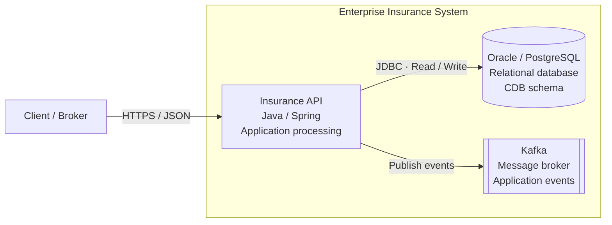
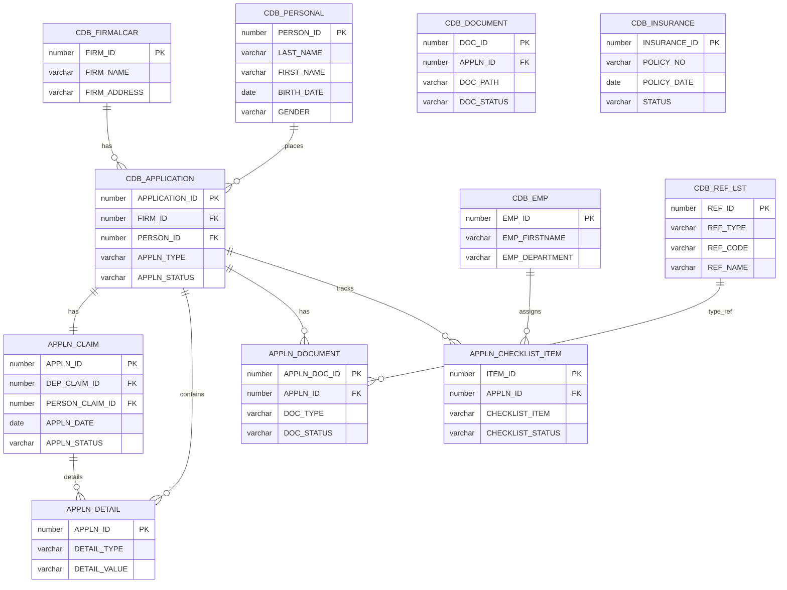

# Enterprise Insurance System — Architecture Case Study

> **Portfolio demonstration.** This is a conceptual architecture assembled from the supplied C4 and ERD snippets. It is not a verified description of a production system. The database engine (Oracle or PostgreSQL), Java/Spring implementation, and Kafka integration must be confirmed against source code or deployment configuration before being presented as factual.

## Scope

This case study documents two complementary views:

- **Container view (C4-inspired):** client/broker, Insurance API, relational database, and Kafka.
- **Data view (ERD):** CDB and APPLN tables and the relationships supplied in the source model.

## 1. Container architecture

The source used the C4 `C4Container` notation. For reliable rendering in GitHub README files, the following equivalent high-level view uses standard Mermaid flowchart syntax.

### Components

| Component | Technology stated in source | Responsibility |
|---|---|---|
| Client / Broker | External user | Submits and follows up applications |
| Insurance API | Java / Spring | Application processing and business logic |
| Relational database | Oracle / PostgreSQL (unverified alternative) | Stores CDB data |
| Message broker | Kafka | Carries application events |

## 2. Database entity-relationship diagram

The diagram below preserves the entities and relationships from the supplied model. It intentionally does not add inferred foreign keys.

## 3. Data model notes and validation points

The following points need confirmation against DDL, ORM mappings, or application code:

1. `CDB_DOCUMENT.APPLN_ID` is marked as an FK in the supplied attributes, but its relationship to `CDB_APPLICATION` was not included in the supplied relationship list.
2. `APPLN_CHECKLIST_ITEM` is related to `CDB_EMP` in the supplied relationship list, but no employee FK column is shown in that table.
3. `APPLN_DETAIL.APPLN_ID` is shown as a primary key while the model also relates an application to multiple detail rows. Confirm whether the actual key is composite or whether a separate detail identifier exists.
4. `APPLN_CLAIM` is shown as one-to-one with `CDB_APPLICATION`; verify the uniqueness and nullability constraints in the database.
5. `CDB_INSURANCE` is present in the entity list but has no supplied relationships. No relationships have been invented here.
6. Oracle and PostgreSQL are presented as alternatives in the source description, not as confirmed simultaneous database platforms.

## 4. Suggested verification sources

To turn this conceptual model into verified system documentation, inspect:

- Database DDL and constraint definitions (PK, FK, UNIQUE, NOT NULL).
- Java entity classes, repositories, and ORM mappings.
- Spring controllers and service-layer code for request processing.
- Kafka producer configuration, topic names, event schemas, and retry/error handling.
- Deployment configuration to establish the actual database engine and runtime topology.

## 5. Portfolio skills demonstrated

- C4-style container architecture documentation.
- Relational data modeling and ERD documentation.
- Mermaid diagrams as code.
- Data dictionary and schema review.
- Traceability between application components and persistence.
- Explicit separation of verified facts from assumptions.

## Status

**Draft — conceptual model, not implementation-verified.** Diagram syntax is prepared for GitHub Mermaid rendering. Structural and semantic correctness of the architecture still requires validation against the implementation.
